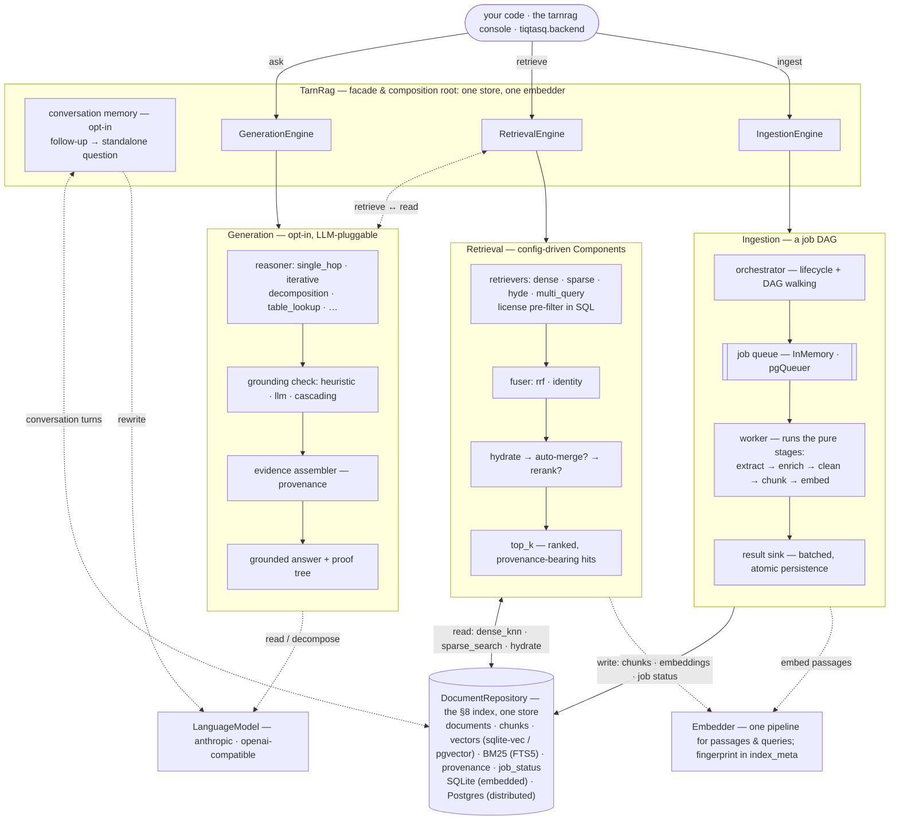

# Architecture overview

tarn.rag is three engines over one store, with a facade wiring them together — and, optionally, a
conversation layer in front of them. This page explains
the shape and the invariants that hold it together; the full design specs live in
[`doc/`](../../doc) and the contributor-oriented deep dive in [`CLAUDE.md`](../../CLAUDE.md).

## The three engines

`TarnRag` is the composition root: it builds the one store (the repository) and the embedder once
and injects both into all three engines — one connection, so retrieval sees ingests live. Each
engine is also usable standalone via its `create()` factory, built from `Settings`.

## One store: the §8 index

Everything lands in a single `DocumentRepository`: documents, chunks, dense vectors, the sparse
(BM25) index, provenance, and ingestion job status. Embedded mode is one SQLite file (sqlite-vec
for KNN, FTS5 for BM25); distributed mode is Postgres (pgvector). All storage goes through
SQLAlchemy 2.0 Core with dialect-specific behavior isolated to hooks, so the two backends stay
behaviorally identical. The SQLite file is deliberately portable — a future C++ reader can open it
directly.

The structure-aware chunker emits a section tree: **leaf** chunks are the retrieval units (embedded,
BM25-indexed, searched), while **section parents** are stored only so the auto-merger can swap a group
of retrieved siblings for their whole section. A parent is never searched itself, so a section and its
own fragments can't both reach the reader. A parent also gets no Embed job, so a sectioned document
shows fewer embeddings than chunks.

> **Upgrading an index built before leaf-only retrieval:** its section parents still have vectors and
> BM25 rows. Searches already skip them (the `level = 0` predicate), but those rows keep skewing the
> sparse index's document frequencies until the document is re-ingested. Re-ingest to refresh the
> BM25 statistics.

Writes are transactional and idempotent: documents are keyed by a **stable** `source_id`, and
re-ingesting replaces chunks and embeddings rather than duplicating them. Identity (`ID_POLICY`) is
separate from content — every document also stores a `content_hash` for dedup queries. The stored
`documents.content` is the **cleaned** text (line endings, control characters and whitespace runs
normalized; code and tables verbatim), because that's the text every chunk's char spans index into.
The `content_hash` is still computed over the bytes you submitted.

Chunk ids are **content-addressed**: a `uuid5` of the document id, the chunk's position and the hash of
its text. A retried Chunk job therefore reproduces the ids its first attempt handed to the Embed jobs,
and `store_chunks` **replaces** a document's chunks instead of appending to them. A re-ingest that
changes a chunk's text gives that chunk a new id, so a citation to the old text can't silently resolve
to the new one. Chunks in an index built before content-addressed ids keep their random ids until
their document is re-ingested; nothing depends on the difference.

A `source_id` repeated within one ingest call is ingested once, from its last occurrence. In embedded
mode, concurrent ingest calls run one after the other, so two runs of one document never overlap.

## One embedder, fingerprinted

The same embedder embeds passages at ingest time and queries at search time — vectors are only
comparable because the pipeline is identical. That identity (provider, model, dimension, prefixes,
header-path injection, …) is recorded as a fingerprint in `index_meta`, and `RetrievalEngine`
refuses to open an index whose fingerprint doesn't match the current settings. A mismatch is a
configuration error caught at startup, never silently-wrong search results.

## Ingestion is a job DAG

The pipeline is a DAG of **pure stages** (no DB or queue access), executed as one job per
`(item, stage)`. Fan-out is natural: a chunker producing *m* chunks enqueues *m* embed jobs, with
in-flight items traveling inline in the job payload. Three roles stay strictly separated:

- the **worker** computes (runs a stage on a batch and reports the results);
- the **result sink** persists;
- the **orchestrator** owns lifecycle — it records status, finalizes the sink, and enqueues
  downstream jobs *only after* upstream results are persisted, so a crash anywhere requeues rather
  than corrupts.

Embedded mode runs this same machinery over an in-process queue (each ingest call completes
synchronously); distributed mode swaps in pgQueuer over Postgres — the queue is a port, not a
different code path. Jobs are internal: the public surface exposes document status, never job
mechanics.

## Everything else is a Component

Extractors, chunkers, enrichers, retrievers, fusers, mergers, rerankers, classifiers, reasoners,
grounding checkers — all are config-driven Components composed by spec under `Settings.components`
(the [catalog](../reference/components.md) lists them). Comparing methods — hybrid vs. dense-only,
single-hop vs. decomposition — is a config edit, not a code change. Generation is an opt-in layer:
retrieval works LLM-free, and license/scope filtering is enforced as a SQL pre-filter inside the
retrievers. Generation marks everything it retrieves as grounding an answer: on top of the caller's
own purpose, never instead of it. A chunk ingested with `ai_grounding_allowed = false` can be
retrieved but never grounds an answer, and generation's license classes are the purpose's
intersected with `GENERATION_GROUNDING`'s — narrower, never wider. Anything the auto-merger brings
in passes the same filter.

## Conversation memory sits in front of the engines

Everything above answers one question at a time. Conversation memory — off by default, switched on by
`components.conversation_memory.enabled` — lets a follow-up such as *"which oil grade does it
require?"* resolve against the last few turns. It is deliberately the smallest thing that can do
that: before `retrieve`, `explain` or `ask` runs, one LLM call rewrites the follow-up into a
**standalone question**, and the engines then run on that question exactly as they would have anyway.

Three choices shape it.

**It is a rewrite, not extra context for the reader.** The conversation is shown to the rewriter and
to nothing else. The reader still sees a question and retrieved passages, and an answer is still
built from — and checked against — those passages alone. History decides *which question is asked*;
it never becomes evidence. The alternative, putting the transcript in the reader's prompt, would let
an earlier answer flow into a new one without a citation, past the grounding check.

**It lives in the facade, not in an engine.** `tarnrag/conversation/` depends only on `core` and
`contracts`; it imports neither `retrieval` nor `generation`, and neither imports it. `TarnRag`, the
composition root, is the one place that knows all of them, so it applies the layer and hands each
engine an ordinary `Query`. The retrieval core therefore stays LLM-free by default and portable, the
`Query` wire contract does not grow a conversation field, and one rewrite serves all three
operations. The cost is that memory is a facade feature: an engine used on its own, and the eval
harnesses that drive engines directly, are stateless.

**The memory is a window over stored turns.** Turns are persisted in the one store (a
`conversation_turns` table beside the index, reached through a narrow `ConversationStore` port) and
kept until deleted; only the last `max_turns` are ever shown to the rewriter. `ask` and `retrieve`
record a turn. `explain` does not — it is a dry run that shows what `retrieve` would search without
changing the conversation. Because a rewrite changes what is searched, each turn keeps the question
both as typed and as run, and a follow-up that could not be rewritten is used as typed *and reported*.

One `TarnRag` is one conversation: fresh on each open unless a `session_id` is configured or passed.
The design record, with every decision and the drawback accepted for it, is
[`doc/conversation-memory-design.md`](../../doc/conversation-memory-design.md).

## Where the deep detail lives

| Topic | Spec |
|---|---|
| Ingestion requirements & job model | [`doc/FUNCTIONAL_REQUIREMENTS.md`](../../doc/FUNCTIONAL_REQUIREMENTS.md) |
| Retrieval subsystem (ModusQ) | [`doc/ModusQ_RetrievalSubsystemSpec.md`](../../doc/ModusQ_RetrievalSubsystemSpec.md) · [`doc/retrieval-architecture-design.md`](../../doc/retrieval-architecture-design.md) |
| Generation design | [`doc/generation-architecture-design.md`](../../doc/generation-architecture-design.md) |
| Conversation memory | [`doc/conversation-memory-design.md`](../../doc/conversation-memory-design.md) |
| Layout-aware extraction | [`doc/structured-document-design.md`](../../doc/structured-document-design.md) · [`doc/extraction-seam-design.md`](../../doc/extraction-seam-design.md) |
| Measured results & phase history | [`doc/phases.md`](../../doc/phases.md) |
